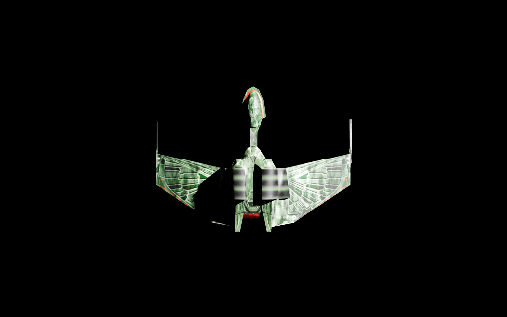
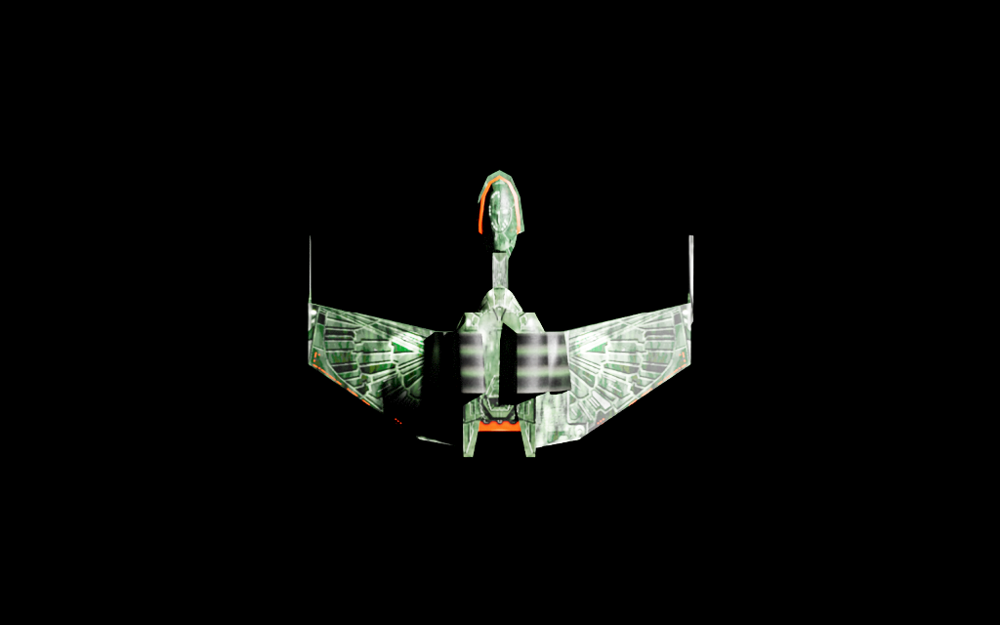
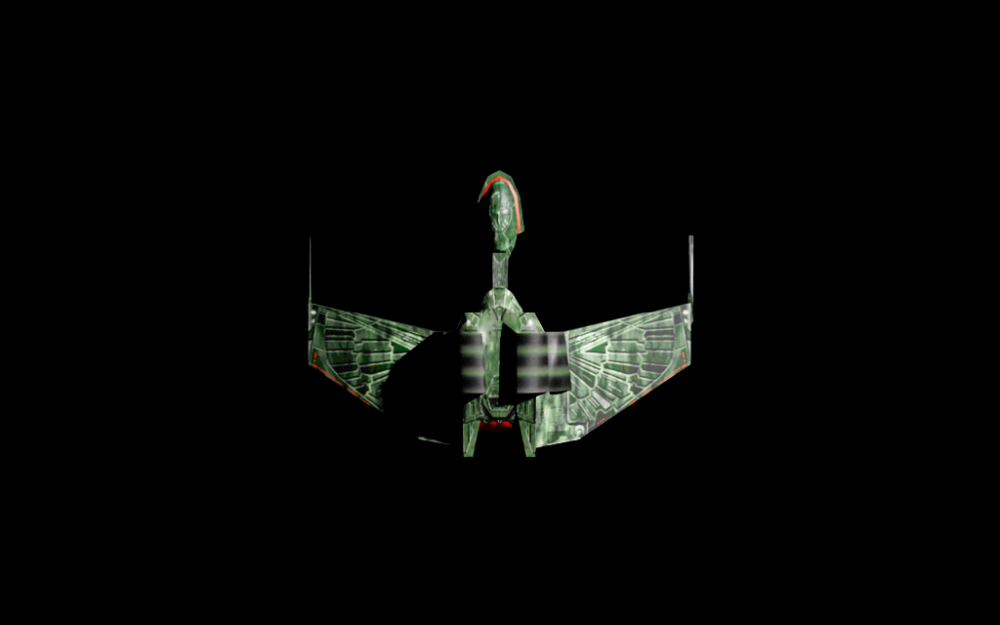
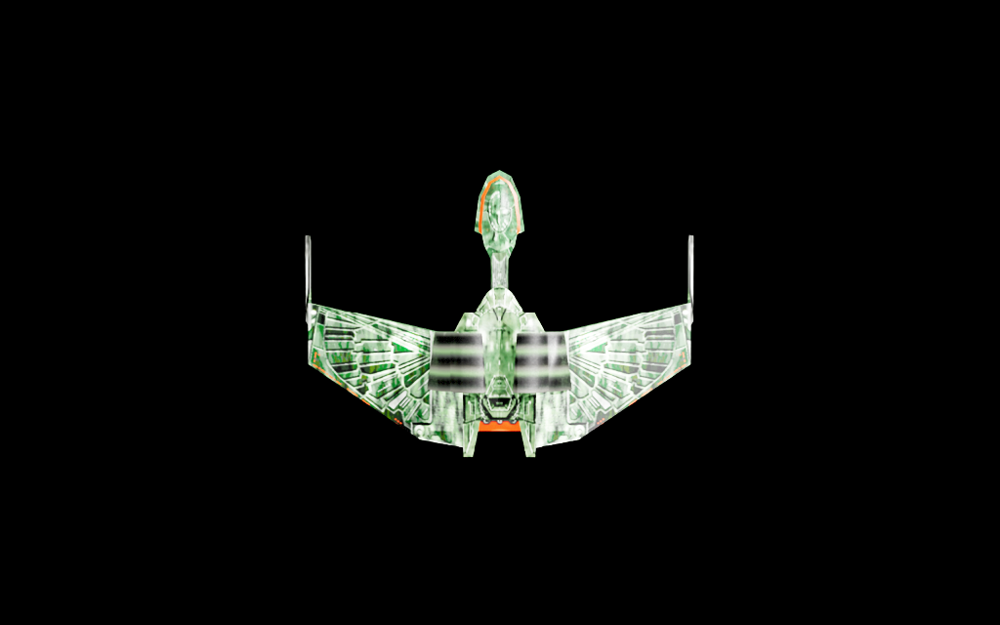

# Offline preview — brightness, dark patches and comparison evidence

2026-10-16. Sponsor approved this investigation while away. Captured/imported model
and original textures unchanged; no SFC run, source repair or default-policy change.
Sponsor also reported the previous **provisional lighting** preview "Looks right
from here": appearance feedback, not verification of SFC's missing branch inputs.

## Findings

Sponsor later reported the same practical experience while making models:
model-program strength needed lowering while appearance in SFC was fine. This
supports treating viewer illumination as a separate calibration issue, not
changing source textures or game lights. It does not establish the exact shader/
color-space cause; original diagnostic confidence below is unchanged.

- **CONFIRMED:** turning down only the preview's synthetic light makes the ship
  substantially less washed out. That brightness is controllable in the preview;
  it is not evidence of texture-recovery damage. No claim that quarter intensity
  reproduces SFC lighting or solves every color-space/material difference.
- **CONFIRMED, for the observed patches:** temporary whole-surface emission makes
  the previously black wing/body areas show their texture. They are not simply
  missing captured triangles. This does not establish the completeness of every
  ship surface, other LODs or secondary geometry.
- **CONFIRMED numeric relationship:** 449/452 triangles have averaged corner normals
  strongly opposed to their geometric right-handed face direction (cosine<−0.1),
  two near perpendicular, one aligned.11 mesh prims all report rightHanded.
  Strong evidence of a convention/lighting-interpretation issue; **not proof**
  whether source winding, vector meaning or consumer interpretation should change.
- Left-handed orientation and two-sided USD session requests did **not** resolve
  the patches. Authored values were read back, but their actual GPU-facing effect
  is unproven. Do not repeat them blindly or claim "fixed culling".

Thus the dark/open-looking appearance is strongly associated with shading/vector
interpretation rather than absent data in those regions. A normal-sign correction
is a candidate, NOT an approved/applied repair. Source normals/winding/UVs remain
untouched. Do not flip them simply because a screenshot looks better.

## Read-only surface audit

`tools/remix_ingest/audit_mesh_surface.py` on accepted import geometry.json:
`artifacts/remix-ingest/20261016-surface-audit.json`.452 triangles;449 opposed,
2 near perpendicular,1 aligned;658 edges used twice and40 boundary edges with
local coordinates rounded6decimals **for analysis only**; zero shared edges with
same-direction traversal. Boundary edges may be intentional/open components;
not evidence alone of dropped faces. No welding/normal recalculation/mesh output.
Existing accepted corner comparison links this inspected geometry to capture;
no need to repeat capture or the prior texture-pixel audit.

## Controlled runs

All use same no-emission accepted textured input, full-detail residency, synthetic
camera/lights and fixed above view. Original control:
`C:/Project/RemixJobs/preview-20261016-184126Z-4af65ccc`.

| Job under C:/Project/RemixJobs | Only experimental change | Observed result |
| --- | --- | --- |
|preview-20261016-201826Z-5fdec919|anonymous mesh orientation rightHanded→leftHanded|visually unchanged; RGB RMS difference~0.36/channel|
|preview-20261016-201859Z-960e0961|synthetic dome/key0.7/2.0→0.175/0.5|less washed out; patches remain|
|preview-20261016-201959Z-20f5e380|anonymous doubleSided false→true|above.png pixel-identical to control; no visibility response established|
|preview-20261016-202107Z-52d51d40|same primary images temporarily used as intensity1 emission|dark patches become visible textured surface|

All clean exit/READY452triangles/11prims/zero owned processes. Source USD/five
diffuse DDS hashes unchanged in all four. Explicit readback records in each job.
First orientation run's generic ready.mesh_edits=false predates metadata
clarification: its orientation attribute **was** changed in anonymous session,
as preview-facing-test.json proves; numeric arrays/source file were not changed.
Later metadata separates numeric edits from mesh-attribute edits. Preserve raw
records and this correction, do not rewrite the old job.

Foreground encoded-image luma (control mask sumRGB>30)163.38→107.42 for quarter
light; this is an image-space diagnostic, NOT calibrated exposure/linear luminance.
No exposure/gamma/material tweak in that test. Whole-surface emission intentionally
adds nonphysical light/spill and is not a normal appearance or recovered-glow mode.

## Matched provisional-lighting comparison

Five assignments remain coherent against same-capture manifest and existing UVs:

| Group | Primary ID/image | Secondary ID/image | Provisional mask |
| --- | --- | --- | --- |
|0|170 kff_1_2|171 kff_1_2i|group_000, primary×secondary|
|1|172 kff_1_1|173 kff_1_1i|group_001, primary×secondary|
|2|174 kff_1_4|175 kff_1_4i|group_002, primary×secondary|
|3|176 kff_1_3|177 kff_1_3i|group_003, primary×secondary|
|4|178 kff_1_5|179 kff_1_5i|group_004, primary×secondary|

IDs above are offline provenance labels, never new-process live pointers. Existing
preview-provisional-lighting.json confirms matching five shader paths/primary names/
product paths. This confirms association, not unqualified SFC glow role or exact
surface placement/fidelity. Current encoded product/intensity1 remain assumptions.

Four selected **unchanged PNG copies** below are curated versionable evidence,
not bulk output or edited composites. Same1024×640 camera/framing; emission can
alter indirect lighting, so differences are not exclusively one isolated pixel.

### Primary textures, provisional lighting OFF

### Provisional lighting ON (sponsor-recognized)

### Quarter-strength synthetic light, provisional lighting OFF

### Whole-surface emission visibility test — deliberately nonphysical

## Next bounded verification / remaining uncertainty

When sponsor returns, prepared start_texture_export_session.ps1 already provides
the single normal90s two-ship fixture: no special maneuvers/timestamps, two exit
cues then normal exit. Capture both +3D58 and +8009, correlate its own resources,
and adjudicate the actual legacy branch. No need to repeat sponsor recognition,
pixel recovery or mip tests. Brightness is not calibrated to SFC; vector polarity/
normal interpretation remains a separate explicit conversion question. No normal,
face, brightness or renderer-policy fix adopted here. No current sponsor action.

[Execution record](../runs/2026-10-16-codex-preview-surface-investigation.md).
