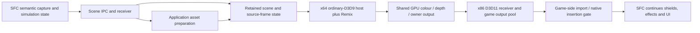

# Renderer and transfer ownership after asset separation

Read-only source audit, November 10, 2026. Parent `7ae2c35` plus the
asset-preparation separation. This is an ownership review, not authorization to
change protocols, timing, presentation, dependencies or the renderer architecture.

## What actually runs

Normal play uses the `Session` application coordinator and the
`async_material_checkout.Relay → progressive_scene_relay.Relay →
multi_scene_relay.Relay → live_owner_timing.Relay` inheritance chain. Despite
historical names such as "checkout", "experimental", "timing" and "calibration",
parts of these modules are essential runtime code. Their names do not establish
that they can be removed from production.

The original game's existing dgVoodoo/D3D11 and ReShade integration remains.
The external host submits ordinary D3D9 geometry to Remix. This is not a new C API
geometry route, Toolkit ingestion or OBJ conversion. Generated Remix material
definitions are distinct from geometry transport. The API alternative and D3D12
remain separately tracked work.

## Current owners

| Responsibility | Current source / important boundary |
| --- | --- |
| Semantic capture, owner/lifetime and native submission coordination | `tools/m1_component/m1_component.cpp`, live-scene headers and native-insertion contracts; inside x86 game, original capture precedes suppression |
| Scene mapping and four asset-transfer acknowledgements | `tools/remix_ingest/live_bridge.py`, `live_scene.SceneChannel`; normal transport remains here, neutral decoding now comes from `src/assets/mesh_decode.py` |
| Receiving/qualifying transferred asset revisions | `tools/remix_runtime/present_calibration.Receiver`; required runtime class shares a file with `read_semantic`, `analyze` and qualification helpers |
| Geometry/image/material construction and task-local reuse | New `src/assets` modules; no Toolkit or capture-review dependency on the normal path |
| Retained catalog, instances, publication and prewarm lifecycle | Four Relay classes above; hierarchy owns distinct preparation, catalog, enhancement and process-lifetime stages |
| Current owner-content identity cache and rebind request | `tools/d3d9_proof/owner_rebind.py`; `Content` reads/hashes original images and caches signatures, while neighbouring functions publish control records. This mixed identity/transport boundary remains for the next separation |
| Input geometry/texture shared-memory lifetime | `tools/remix_runtime/texture_memory.Pool`; immutable payloads stay owned until catalog acknowledgement, then reclaim; not the rendered-output surface pool |
| Current-user scene/catalog/control layouts | `scene_capacity.py`, `multi_scene.py`, `warm_start.py`, light transport and corresponding native headers; versioned/paired ABI, not generic untyped dictionaries |
| Bounded supervisor service | `tools/d3d9_proof/recovery_service.Service`; drains receiver and polls scene/light/rebind state, joins before mappings are freed |
| Renderer backend selection and process environment | `runtime_candidate.py`, `async_material_checkout.configure_child/backend_inputs`; functional installed selection is mixed with development fetching/build receipts |
| D3D9 device, mesh/texture upload, ordinary draw submission, Remix presentation | `tools/d3d9_proof/d3d9_direct_host.cpp` and runtime headers. This is production native source even though it is under tools |
| Host-to-receiver output ownership | `output_producer.h`, `output_channel.h`, `output_startup.h`, `receiver_activation.h`; `OutputPeer` creates/monitors the receiver, maps shared metadata, and preserves resource generations |
| Imported output copy and GPU completion | `output_receiver.cpp`, `worker_gpu_fence.h`; x86 D3D11 receiver, continuous readback disabled for game output |
| Game-local colour/depth/owner surfaces | `game_output_writer.h`, `game_output_wire.h`; binds late validated asset/session identity, creates generation-specific shared surfaces and publishes after completion |
| Native game import, leases, colour/depth insertion | `tools/remix_runtime/d3d9_game_receiver.h` through `return_addon.cpp`, with native gate/cohort contracts; distinct from a desktop overlay |
| Gate timing, membership and output matching | Native-insertion headers plus Python `native_gate`/`native_cohort`; Python files also include qualification/evidence functions |
| Overall exit/recovery and protected files | `src/session` and `src/runtime`; retain the accepted shared teardown and graphics transaction |

## Couplings to preserve or separate deliberately

- Asset preparation is now application-owned, but `Pipeline` still receives its
  established Relay context and publishes the existing D3D9 packet/catalog form.
  This source move does not create a renderer-agnostic SDK. Neutral captured
  positions/normals/UVs are separate from Remix image-origin/material rules.
- `material_binding` and `material_library` are Remix-specific material adapters;
  `remix_coordinates.py` remains in the existing adapter area. A future renderer
  must use original data and its own conversions.
- `live_owner_timing.launch` uses the scene packet reader to compute a geometry
  span. Therefore `scene_bundle.read_replay` is functional, despite its name;
  removing it with capture analysis would break startup.
- Base catalog publication and enhancement publication are separate. The current
  `material_prime_ready` receipt means private renderer startup completed, not
  acknowledgement that each material has been installed. This distinction belongs
  in ownership documentation; it does not establish the cause of the sponsor's
  perceptible startup stages. That investigation remains parked.
- Retained instance identity, source frame/camera/pose, asset revision, activation
  generation, output resource epoch, readiness and GPU leases cross multiple
  layers. A source move must preserve their transaction relationship and fallback.
- Teardown crosses Relay inheritance: service stop/join, source stop, active or
  passive renderer retirement, preparation closure and texture-pool release. The
  application then collects small exit facts and closes the receiver mapping.
  Treat it as one lifecycle; do not move just an apparent `stop()` leaf.

## Smallest next separation

First separate **scene receipt and input transport** into application source:
the functional `Receiver` from calibration analysis, shared scene/catalog/startup
contracts, immutable input-payload ownership, and the service lifecycle. Split
`owner_rebind.Content` into asset/identity ownership while keeping request/ACK
functions with transport. Preserve public aliases and all wire layouts. Keep
calibration analyzers, raw timing/census capture and fixture drivers in tools.

Then separate **normal renderer orchestration/backend selection** from fixture
setup, downloads/build receipts and timing analysis. Preserve the existing Relay
inheritance first rather than redesign it during relocation. Native renderer,
receiver and game-side compositor sources form a later paired move: x64/x86
include graphs, build definitions, loaded file roles and tests must move together.

No transfer redesign, renderer replacement, queue-depth change, new waits,
validation removal or CPU screenshot path was implemented in this audit. Existing
GPU leases and completion checks are runtime ownership requirements, not optional
capture diagnostics. Native source and the accepted renderer binary are unchanged.
