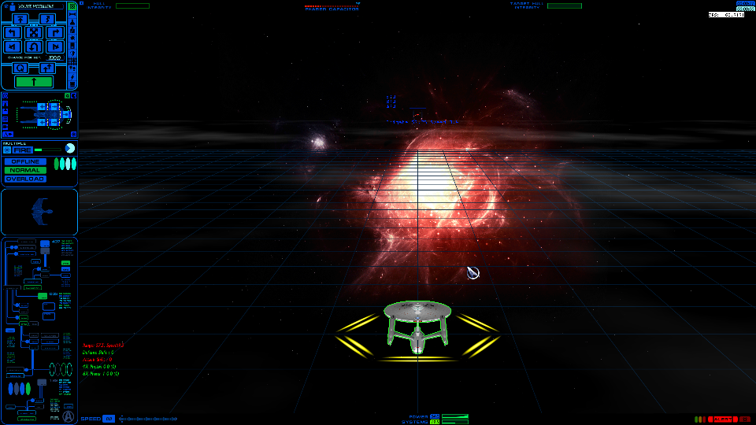

# Codex run — contemporaneous calibration runtime review

Run SFC-RETURN-20261017-19,2026-10-17 America/New_York. Sponsor completed prepared
test and reports "ok ran the test, not issues noted". Evidence directory timestamp
is UTC20261018-025737-262069-in-game (local Oct17),not another-day gameplay claim.
HEAD e96765a,indexempty,existing dirty/untracked work preserved. Read HANDOFF,
Run17/18,approved calibration probe and actual result/manifest/sidecars/native logs.
FuelGuard actual-thread hook attached,no daemon/helper/subagents/new game launch.

## Result

**CONFIRMED:contemporaneous semantic/native-depth capture demonstrated.** Three
submissions retain both fresh owner/model/revision records in the same engine
frame,render thread,session and native Present/resource epoch;not a nearest-time
join. Original operation normal by sponsor report;normal exit,hook restore/unload,
copied proxy/config rollback and unchanged critical files all pass.

**Projection/depth calibration PARTIAL,with a material positive result:**the close
FCA silhouette aligns with mathematically projected geometry;~98%of tested
interior pixels agree with native depth within2e-5of8MSAA min/max interval. Native
screen z matches directly;the old standalone SDK half-z-plus-half mapping does
NOT match the game's depth. A conversion correction is now mathematically
identified but not applied to a renderer here. No ship hidden,no replacement or
formal milestone/TRL PASS. Distant KFF visible projection only4–6half-grid pixels,
no interior left for reliable depth qualification;do not claim both depth-proven.

## Runtime evidence / confidence

|Evidence|Observed result|Classification|
| --- | --- | --- |
|Engine frame/native Present|120/842,420/1142,720/1442;relative0/4.9968693/9.9963267s|CONFIRMED sidecar/paired packet stamps|
|Render thread/session|19380,unique session28eea38b49264932909ae66565bd1a2d;all snapshots match|CONFIRMED|
|Owner1|KFF,revision1,452triangles,fresh asset captured frame3|CONFIRMED packet/content + same-frame model/source/owner|
|Owner2|FCA,revision2,6370triangles,fresh asset captured frame4|CONFIRMED same evidence|
|Camera independent composition|All6owner samples pass;max0.0001725495pixel error|CONFIRMED native M/V/P/viewport math,not camera-control-mode interpretation|
|Scene transport|984records/568796B,two attempts/two transfers;zero capture failures,drops,invalid,overflow,unsent,I/O errors|CONFIRMED worker result|
|Depth|3pairs,1920x1080/8samples/native10_1,ps_4_1;zero GPU/I/O errors,ambiguity or pending loss|CONFIRMED|
|Sponsor behavior|No issues noted|CONFIRMED sponsor observation,not instrumented equivalence|

Assets captured earlier than poses are same-session unchanged rigid revisions,
not falsely contemporaneous geometry copying. In-place deformation remains
unqualified. Raw result still uses generic REMIX-RETURN-001 label/pending sponsor
field;manifest+sidecar establish REMIX-CALIBRATION-001. Curated evidence adds
sponsor report without rewriting raw run record.

## Offline projection adjudication

New analyze_present_calibration.py verifies exact paired provenance,decodes fresh
mesh/refs,validates native camera arithmetic,projects each actual polygon's corner
indices using captured composed matrix. No fit,UV/normal/orientation edits,owner
substitution or image registration. Opaque double-sided geometric reference only,
NOT material/alpha/culling emulation. Near/behind-camera triangles fail rather
than guessed clipping. Reference grid uses source pixel centers(2x+.5,2y+.5),
one half-grid-cell boundary erosion. Compare predicted depth with all-eight-sample
min/max interval;do NOT claim exact per-sample coverage from aggregate captures.

FCA:3236/3236/3190projected half-grid pixels;2785/2785/2745interior pixels.
Within2e-5 native-Z interval:2729/2729/2689 (~97.99/97.99/97.96%). Median error
2.27436e-6/2.27436e-6/2.34534e-6;95th1.14928e-5/1.14928e-5/1.16746e-5.
Half-z-plus-half:ZERO interior matches,median mismatch~.01228. No fitted
tolerance/scale/depth offset was used to select the winner. The residual~2%
is not resolved;pixel sample positions,edges,face selection and overlapping
scene content remain possibilities,not assigned causes. No full visibility PASS.

Inspected projection overlay frame720:green predicted FCA outline tracks visible
ship in actual color,while combat effect remains separate scene content. This
corroborates numerics,not the sole ownership evidence. KFF too small to adjudicate.



### Discovered depth conversion requirement

With native projection coefficients a=P22,b=P23 and positive view distance d,
native screen depth is -a+b/d. Standalone replay previously used conventional
near=b/(a-1)≈1.00000006,far=b/(a+1)≈30013.91055,which gives .5*nativeZ+.5.
To match native depth using a standard D3D parameterized camera,the arithmetic
solution is near=b/a≈1.99993349 and SAME far. Unit tests independently establish
equivalent coefficients,without a fit to these pixels. Screen XY/FOV need not
change. This is a derived depth equation,NOT a claim of the game's true clipping
policy or proof the SDK accepts/outputs the intended correction. Next qualify it
offline through actual Remix depth/coverage outputs before any original suppression.

## Changes / validation / reproducibility

Added tools/remix_runtime/analyze_present_calibration.py and
tests/test_present_projection.py (7tests:fixed sample positions,triangle winding,
nearest depth,linear interpolation,malformed input,MSAA interval/interior and
coefficient conversion). First exact floating-point equality assertion failed on
reversed winding due arithmetic roundoff;corrected test requires identical finite
coverage plus1e-14absolute depth agreement,not changed rasterization to force fit.
Final180Python tests PASS2.879s. Existing runtime code/binaries unchanged.

```text
python tools/remix_runtime/analyze_present_calibration.py artifacts/remix-runtime/runs/20261018-025737-262069-in-game --images
python -m unittest discover -s tests -p test_*.py
python tools/remix_runtime/archive_broad_evidence.py artifacts/remix-runtime/archives/20261017-present-calibration-runtime.zip artifacts/remix-runtime/runs/20261018-025737-262069-in-game
git diff --check
```

Python=bundled3.12.14,TEMP/TMP artifacts/test-temp. CLI writes generated analyses
and at most3projectionPNG derivatives;raw depth/semantic/mesh/image associations,
manifest/result/logs unchanged. Curated PNG copied byte-identically,not edited.
New versionable curated JSON,this record,probe runtime disposition,readiness and
HANDOFF updated. No new process/hook/probe configuration or instrumented gameplay.

## Bounds / cleanup / warnings

Prepared workflow97.453s;20s capture/24s semantic controller unchanged. Images
51,610,954B (raw+existing derivatives+three projection overlays)<64MiB;whole
58,481,990B<96MiB. Warning32MiB is expected,not runaway output. Added analyses
are bounded;no image streams or geometry firehose. Scene mapping16MiB;37392B
semantic sidecars,only two fresh revisions. Raw/capture small enough to retain.

Archive5632788B,41entries/51,884,776Bsource,CRCverified,
SHA85FA1B119880837C6A497F1E7C6ECF702FE4E87D2D0A3FC63ED775C8EA9F58BC.
Archive retains raw depth/semantic/fresh meshes/refs/logs/JSON/existing depthPNG;
new projectionPNGs are regenerable and remain loose;final comparison also curated
versionably. No raw deletion;coexistence below approved10GB.

Controller0,component_state=removed,hook_bytes_restored=true,component_unloaded=true;
launcher normal childexit0,control-only host0,proxy/config restored. No Remix
render host was used. ReShade has FIVE startup reference warnings54 plus final
warning67. Compared Run15:also5startup54warnings;not newly introduced or fixed.
Warnings remain unresolved despite normal exit. Separate SDK40warning still open.

All7critical files of both installations still match actual result hashes;both
clientSHA4D65761D7DD69EF1504070261B81E9C200C0AF18105033E1C4D2222C62320C29.
No active SFC/controller/host session;HEAD e96765a,indexempty,prior dirty work plus
new analysis/evidence unstaged/untracked,nothing staged/committed. Light-bank
state was NOT captured;Run18 static findings remain separate.

**Exact next action:**offline-qualify native-Z-equivalent camera conversion with
the pinned Remix SDK on these fresh assets/poses,before planning suppression.
No repeat gameplay or appearance/light tuning needed to answer that next question.
